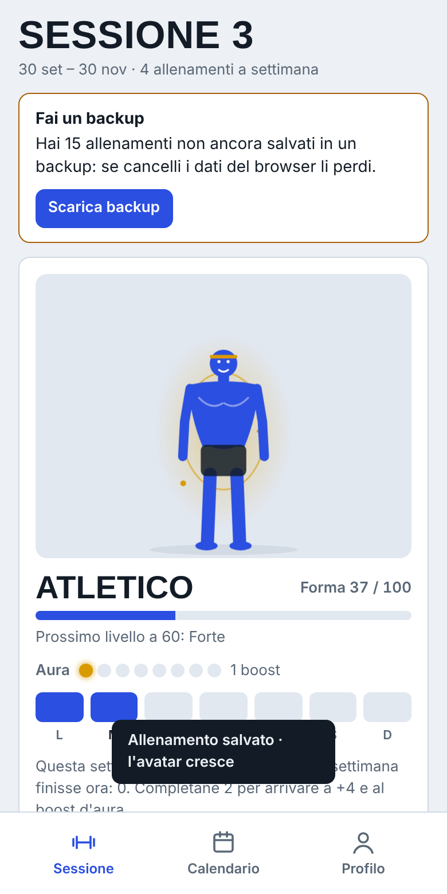
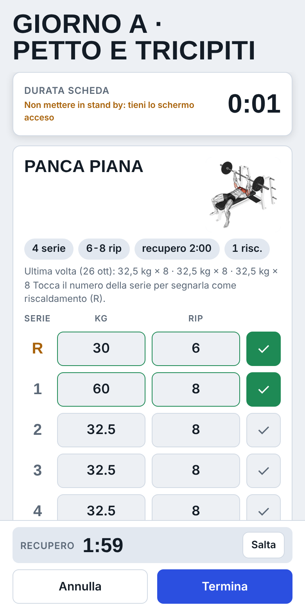
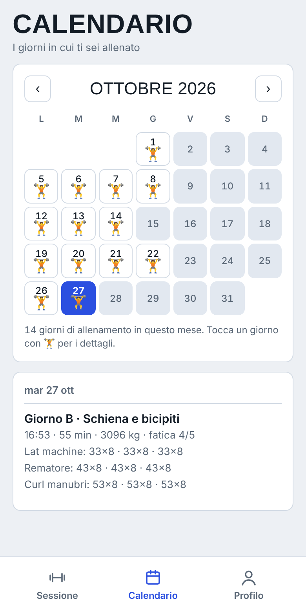

# GymTrack

App per telefono (PWA, un sito statico senza server) per allenarti, seguire una dieta e vedere il tuo **avatar** crescere.
Si organizza in **sessioni** da 1 a 12 mesi: ogni sessione ha le sue schede, il suo avatar e, se vuoi, una dieta collegata.

> Gli screenshot in `docs/` sono di una versione precedente dell'interfaccia.

## Come averla sul telefono

Apri il link dell'app che ti è stato dato (finisce con `.github.io/...`) dal browser del telefono, poi:

### iPhone / iPad
1. Apri il link con **Safari** (non Chrome).
2. Tocca il tasto **Condividi** (il quadrato con la freccia verso l'alto).
3. Scorri e tocca **Aggiungi alla schermata Home**, poi **Aggiungi**.

### Android
1. Apri il link con **Chrome**.
2. Tocca il menu **⋮** in alto a destra.
3. Tocca **Installa app** (oppure **Aggiungi a schermata Home**) e conferma.

Appare l'icona GymTrack nella schermata Home. Si apre a schermo intero come una vera app e,
dopo la prima apertura, **funziona anche senza internet**.

## Le schermate

La barra in basso ha quattro schede; puoi anche **scorrere a destra e a sinistra** per spostarti tra loro.

- **Home**: in alto il tuo **profilo** (tocca per aprirlo e modificare nome, foto, età, altezza, peso, tema, notifiche e backup); poi il riquadro del tuo **campione** (l'avatar); in fondo il **calendario** degli allenamenti.
  - Il **campione** è il riquadro con il tuo **avatar animato** (si allena e, se c'è una dieta collegata, mangia sano). Toccandolo si apre e dà i rimandi alla **sessione corrente** e alla **dieta corrente**, con il collegamento tra le due.
- **Sessioni**: la sessione corrente (tocca per vedere le schede) e lo **storico** delle sessioni passate. Da qui crei una sessione, carichi un JSON, selezioni ed elimini sessioni.
- **Dieta**: la dieta corrente e le diete passate (ognuna con il suo titolo). Tocca una dieta per vedere **piano settimanale** (si apre il giorno di oggi) e **lista della spesa**.
- **Analisi**: statistiche per sessione (con la dieta collegata, se c'è) o per tutto insieme: allenamenti, tonnellate, aderenza, volume per settimana. Ci sono anche i **record personali di tutte le sessioni insieme**, il grafico del **peso** e lo **storico** (per sessione, per esercizio, cronologia).

## Sessioni

Quando ne crei una, l'app ti chiede peso, **obiettivo** (ipertrofia, forza, dimagrimento, mantenimento, ricomposizione), allenamenti a settimana, **durata (1–12 mesi)** e **avatar** (uomo, donna, orso, lupo, gorilla, leone, toro). Puoi anche:

- **copiare una sessione esistente** (schede e impostazioni) come punto di partenza;
- collegare subito una dieta (facoltativo);
- **caricare le schede da JSON** (vedi sotto).

Le schede si possono inserire a mano, caricare da JSON o generare con l'IA (vedi sotto). Le sessioni passate si eliminano dallo storico con **Seleziona**; vengono eliminati anche i loro allenamenti.

### Carica da JSON
Dallo storico, **Carica JSON** legge un file con le schede (formato in [CLAUDE.md](CLAUDE.md)) e chiede **«È la scheda corrente?»**:
- **Sì** → le schede vanno nella sessione in corso (o ne nasce una nuova);
- **No** → indichi periodo e **quanti allenamenti hai fatto**: l'app crea una sessione già conclusa con l'avatar che corrisponde a quel ritmo.

Il JSON si carica come file o si incolla (anche la risposta di un'IA, con testo attorno). **Non hai il JSON?** L'app ti dà un **prompt** da copiare in un assistente IA (Claude, ChatGPT…): gli allegi il PDF della tua scheda e lui risponde con il JSON giusto.

### Schede con l'IA
Dalla sessione in corso, **Genera con IA**: spunti i macchinari della palestra, indichi i minuti per allenamento e le richieste; l'app prepara il prompt (con profilo, obiettivo, schede passate, carichi e record) da incollare in un assistente, poi importi la risposta. In alternativa puoi inviare la richiesta per email al tuo preparatore.

> L'IA **non è un personal trainer**: l'app lo segnala in ogni schermata di generazione. Meglio una scheda fatta da un professionista; l'IA è solo uno spunto.

## Allenamento

Premi **Inizia** su una scheda: vedi la **lista degli esercizi** (nome, serie, ripetizioni, recupero, GIF). Toccane uno per aprirlo: GIF grande, note, serie con kg e ripetizioni (quelli dell'ultima volta sono già compilati), timer di recupero con «Salta».

- Una serie segnata come fatta **non si annulla**. Puoi aggiungere serie e togliere solo quelle aggiunte da te; le ripetizioni sono libere.
- Finite le serie si attiva **Fatto**: torni alla lista e l'esercizio risulta completato (pallino pieno, riga più chiara).
- **Fine scheda** (due tocchi) salva subito l'allenamento, senza domande.
- Se esci a metà, al ritorno ritrovi tutto. Lo schermo resta acceso; a fine recupero ricevi suono, vibrazione e notifica.
- Se batti il tuo storico su un esercizio compare **Nuovo record 🏆**; il tasto 📈 apre il grafico di progressione.

## Dieta

La dieta si carica da un **JSON** (file o incollato, anche con testo attorno). Dal pulsante **Nuova dieta** hai quattro strade:

- **Carica o incolla il JSON** che hai già.
- **Non hai il JSON?** L'app dà un **prompt**: lo incolli in un assistente IA, gli allegi il PDF del tuo nutrizionista (ed eventuale testo) e lui risponde con il JSON.
- **Crea una dieta con l'IA**: l'app chiede quali **cibi o spezie non ti piacciono** (e le allergie), prepara il prompt, tu lo incolli nell'assistente e riporti qui la risposta. L'app avvisa che l'IA **non è un nutrizionista**: va usata solo come spunto.
- **Copia una dieta esistente**.

Poi tre passi:

1. **Quali pasti fai?** (colazione, pranzo, cena, spuntini…).
2. **Cosa mangi davvero?** Per ogni pasto togli gli alimenti che non mangeresti e correggi le **quantità**; puoi aggiungerne altri.
3. **Come cucini?** Titolo, **sessione da collegare (obbligatoria)** e:
   - *Cucino 2 volte al giorno*: piano normale;
   - *Cucino 1 volta al giorno*: l'app chiede **«la sera cucini anche il pranzo del giorno dopo?»**. Se sì, il piano è «intelligente»: a cena e a pranzo mette lo stesso cereale e le stesse verdure e ti dice la quantità totale da cucinare (es. «cucina 180 g in totale»).

Il piano rispetta le frequenze del JSON (es. pesce almeno 3 volte, carne al massimo 5, legumi, uova…) e varia le alternative. La **lista della spesa** somma le quantità della settimana (a crudo) e ha la spunta «preso». Una dieta può servire più sessioni; una sessione può non avere dieta. Il **collegamento** si cambia dalla Home.

## Avatar

Dieci avatar in stile cartoon: uomo, donna, **gatto, cane, alieno**, orso, lupo, gorilla, leone, toro. Ognuno ha la sua faccia (orecchie, muso, coda, antenne…) e un corpo che va da «completamente fuori obiettivo» a «obiettivo perfetto». [Evoluzione per obiettivo](docs/avatar-evoluzione.png) · [Tutte le specie, inizio e fine](docs/avatar-specie.png).

- **Cresce a ogni allenamento** completato verso l'obiettivo: ipertrofia (magro → massiccio), forza (debole → bilanciere sopra la testa), dimagrimento (sovrappeso → asciutto, con sagoma sbiadita del punto di partenza e metro da sarta), mantenimento (fuori allenamento → medaglia), ricomposizione (morbido → tonico, con sagoma sbiadita).
- **5 evoluzioni con nomi per obiettivo**, e l'abbigliamento cambia a ogni passo (dal completo sformato al completo da campione), per esempio: ipertrofia *Fuscello → Pulcino da palestra → Palestrato → Armadio a due ante → Colosso*; forza *Pivello → Ferro in mano → Sasso → Macigno → Titano d'acciaio*; dimagrimento *Morbidone → Sgonfiotto → Scattante → Guizzante → Fulmine*; mantenimento *Pigrone → Si rimette in moto → Costante → Equilibrista → Zen inossidabile*; ricomposizione *Bozzolo → Crisalide → Metamorfosi → Farfalla → Fenice*. Se salti troppi allenamenti ingrassa e il nome diventa buffo (es. «Ferro arrugginito»).
- **L'aura è un'altra cosa**: si accende solo se fai **tutti gli allenamenti della settimana**. A fine settimana (lunedì 00:00) conta `2 × fatti − previsti`: con 4 allenamenti previsti, 3 fatti = +2; 4 fatti = +4 e un **boost d'aura**; 0 fatti = −4. Più boost di fila, più l'aura a fiamme (stile Dragon Ball) è alta e luminosa, e cambia colore (oro → arancio → azzurro elettrico).
- Con le aure si sbloccano gli **accessori**: fascia (1 boost), cintura (3), mantello (5), corona (7).
- Nella Home e nella sessione corrente l'avatar è **animato**: si allena; con una dieta collegata alterna allenamento e pasti sani. Con «riduci movimento» attivo nel telefono resta fermo.

## Tema e dati

- **Tema app** (Home → profilo): 9 combinazioni di colori e aspetto chiaro/scuro/automatico.
- I dati restano **sul tuo telefono**, non vengono inviati a nessuno. L'app tiene una **copia automatica al giorno** (ultimi 7 giorni) e chiede al browser di non cancellarli.
- **Home → profilo → Salva backup** apre il menu di condivisione (Drive, iCloud, email…); **Ripristina** recupera da una copia automatica o da file. Aprendo l'app da un altro telefono parte vuota: usa il backup.
- Le GIF vengono da internet; una volta viste restano offline.

## Per chi sviluppa

Sito statico senza build: `index.html` + `css/` + `js/` (organizzato in `core`, `avatar`, `ui`, `features`, `app`). Struttura, modello dei dati e formati JSON sono descritti in [CLAUDE.md](CLAUDE.md). Il codice è formattato con Prettier (`.prettierrc`). Per provarlo in locale basta servire la cartella (`python3 -m http.server`). I file personali (schede, diete, JSON) vanno in `private/`, che è ignorata da git.

## Crediti
Le GIF e le miniature degli esercizi sono © Gym visual (https://gymvisual.com/), distribuite nel dataset
[hasaneyldrm/exercises-dataset](https://github.com/hasaneyldrm/exercises-dataset). Sono caricate da lì e non incluse in questa app.
