# GymTrack

App per telefono per registrare i tuoi allenamenti, organizzata in **sessioni** da 2 o 3 mesi.
Ogni sessione ha le sue schede e il suo **avatar**, che parte piccolo e debole e cresce con ogni allenamento.

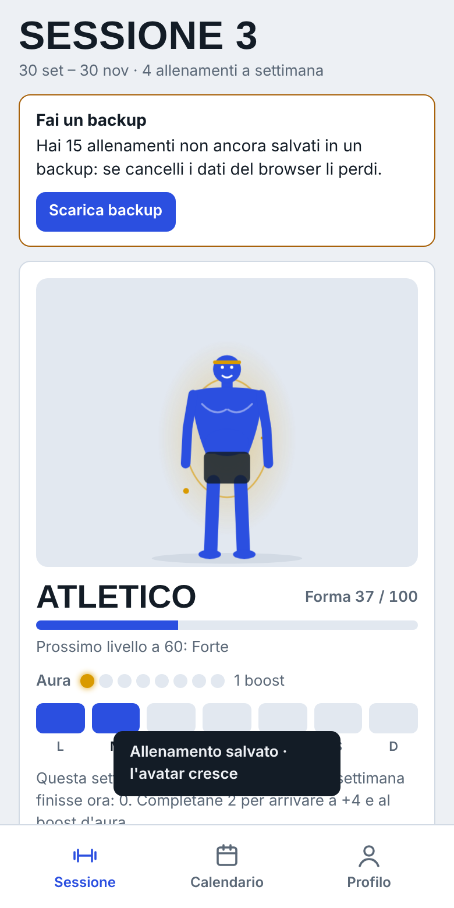
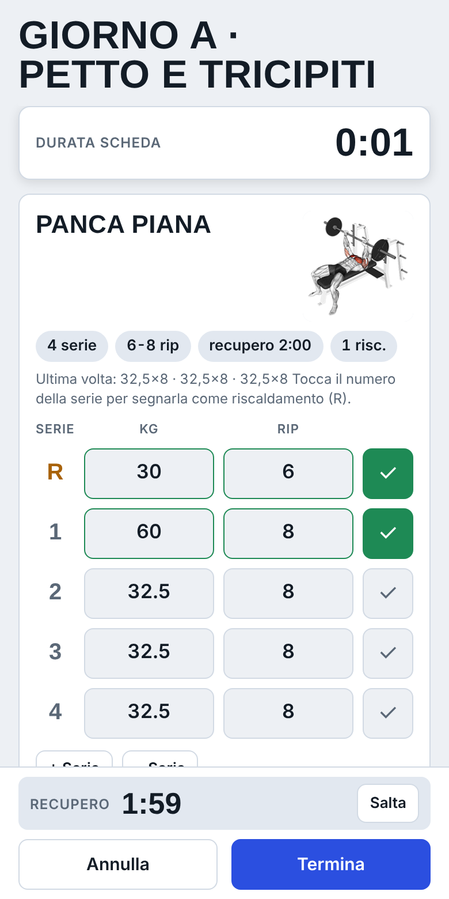
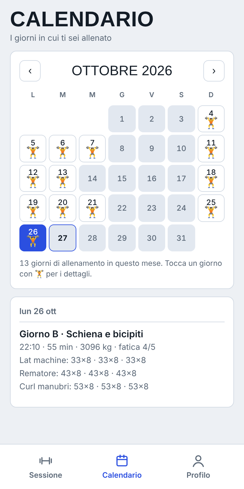

## Come averla sul telefono

Apri il link dell'app che ti è stato dato (finisce con `.github.io/...`) dal browser del telefono, poi:

### iPhone / iPad
1. Apri il link con **Safari** (non Chrome).
2. Tocca il tasto **Condividi** (il quadrato con la freccia verso l'alto).
3. Scorri e tocca **Aggiungi alla schermata Home**, poi **Aggiungi**.

### Android
1. Apri il link con **Chrome**.
2. Tocca il menu **⋮** in alto a destra.
3. Tocca **Installa app** (oppure **Aggiungi a schermata Home**) e conferma.

Appare l'icona GymTrack nella schermata Home. Si apre a schermo intero come una vera app e,
dopo la prima apertura, **funziona anche senza internet**.

## Cosa fa

### Profilo
Foto, nome, età, altezza e peso. Qui trovi anche i **record personali**, il **grafico del peso**, **I miei avatar**
(uno per ogni sessione, concluse e in corso), lo storico di tutti gli allenamenti e il backup dei dati.

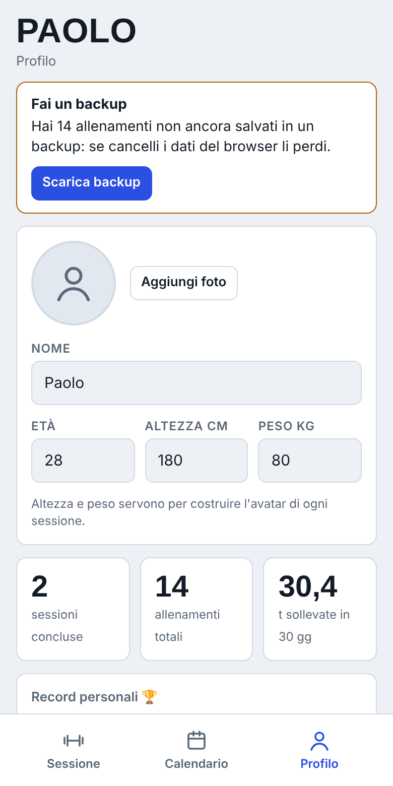

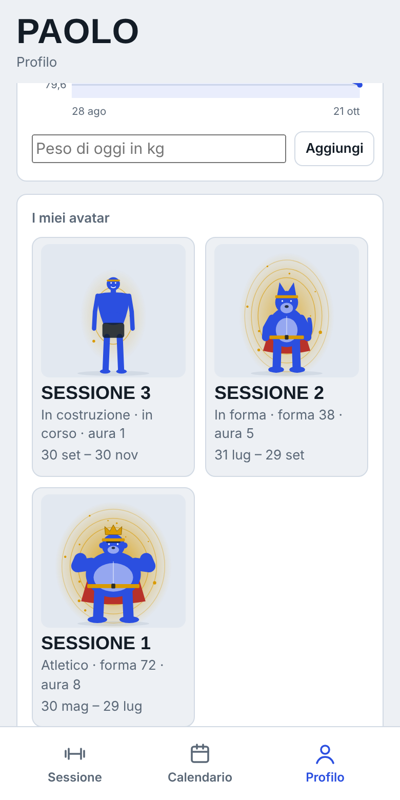

### Sessione
Quando ne inizi una, l'app ti chiede il **peso attuale** (e aggiorna il profilo), prende altezza ed età dal profilo
e poi chiede:
- l'**obiettivo** della sessione (ipertrofia, dimagrimento, ...);
- quanti **allenamenti a settimana** vuoi fare;
- la **durata**: 2 o 3 mesi;
- l'**avatar**: umano, orso, lupo o gorilla.

Poi aggiungi le schede: puoi **generarle con l'IA**, **chiederle a un preparatore via email** oppure **inserire quelle che hai già**.

### Crea scheda
Indichi i minuti che hai per ogni allenamento, cosa vorresti ottenere e spunti i macchinari della tua palestra (divisi per gruppo muscolare). Poi scegli:
- **Genera con IA** (o copia il testo e incollalo in un assistente come Claude): l'IA usa profilo, obiettivo, allenamenti a settimana, minuti, attrezzi, schede passate, carichi usati, fatica e record, e propone anche superset, riscaldamento e la GIF di ogni esercizio.
- **Invia per email**: l'app prepara una email con tutti questi dati, da mandare al tuo preparatore con la tua app email (o da copiare/condividere).

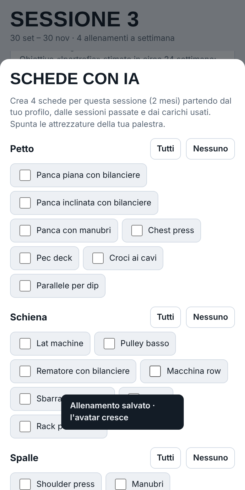
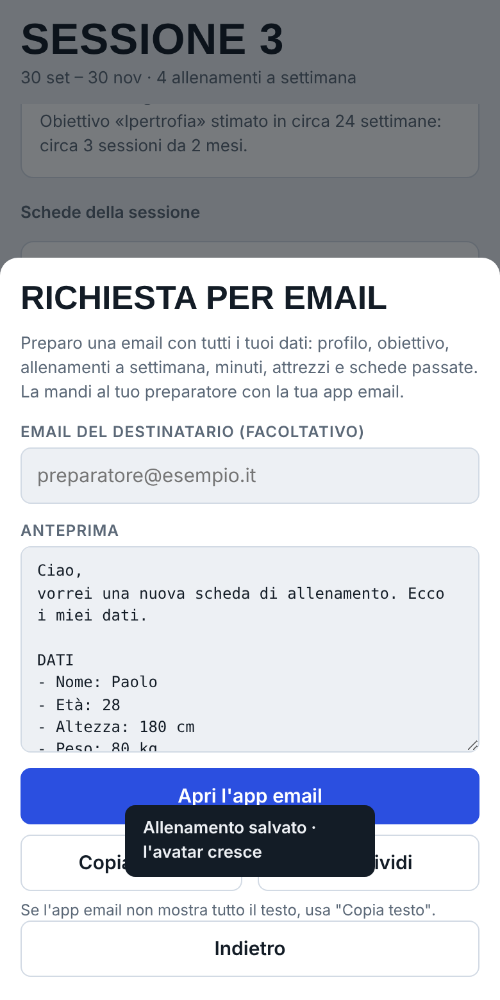

### Schede e allenamento
Ogni scheda è un giorno di allenamento. Ogni esercizio ha **serie, range di ripetizioni, tempo di recupero**, note e una **GIF dimostrativa**
(scelta dal database di 1.300 esercizi; cerca anche in italiano: panca, squat, curl…).

Quando premi **Inizia** parte il **cronometro della scheda**, che a fine allenamento diventa la durata registrata.
Inserisci kg e ripetizioni (i carichi dell'ultima volta sono già compilati) e spunti le serie: parte il **timer di recupero**
e, quando scade, ricevi **suono, vibrazione e notifica**.

- **Riscaldamento**: tocca il numero della serie per segnarla "R": non conta nel volume né nei record. Puoi anche impostare quante serie di riscaldamento prevede ogni esercizio.
- **Superset**: spunta "Superset con l'esercizio successivo": tra i due esercizi non c'è pausa, il recupero parte dopo il secondo.
- Se esci dall'app a metà allenamento, al ritorno ritrovi tutto (cronometro compreso). Lo schermo resta acceso durante l'allenamento.

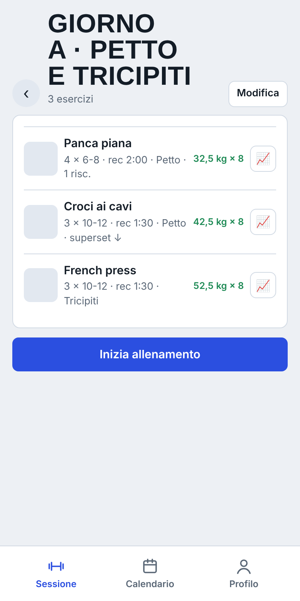

### Calendario
Un calendario tutto dentro l'app, non collegato a quello del telefono. Nei giorni in cui ti alleni compare 🏋️,
negli altri giorni la cella resta vuota. Tocca un giorno con 🏋️ per vedere schede, carichi, durata, fatica e note.

### Fine allenamento, record e grafici
- Quando premi **Termina** indichi quanto è stato faticoso (da 1 a 5) e puoi scrivere una nota.
- Se hai battuto il tuo storico su un esercizio (carico, massimale stimato o volume) compare **Nuovo record 🏆**.
- Il tasto 📈 accanto a ogni esercizio apre il **grafico di progressione** (massimale stimato o volume, ultimi 3 mesi o tutto).

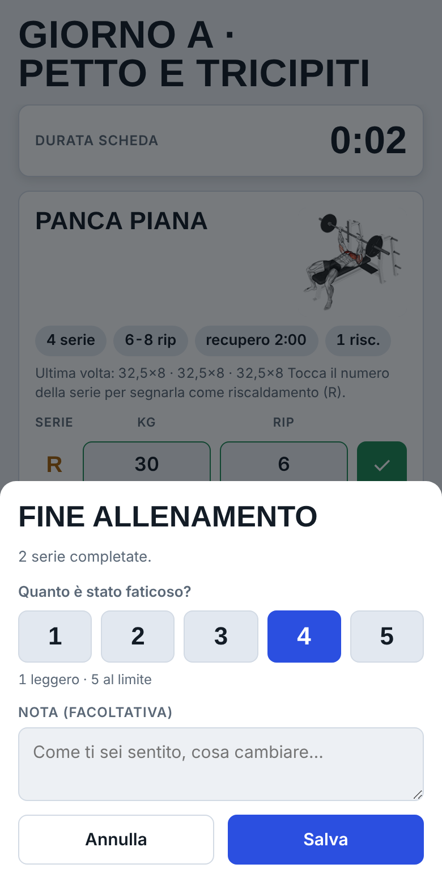
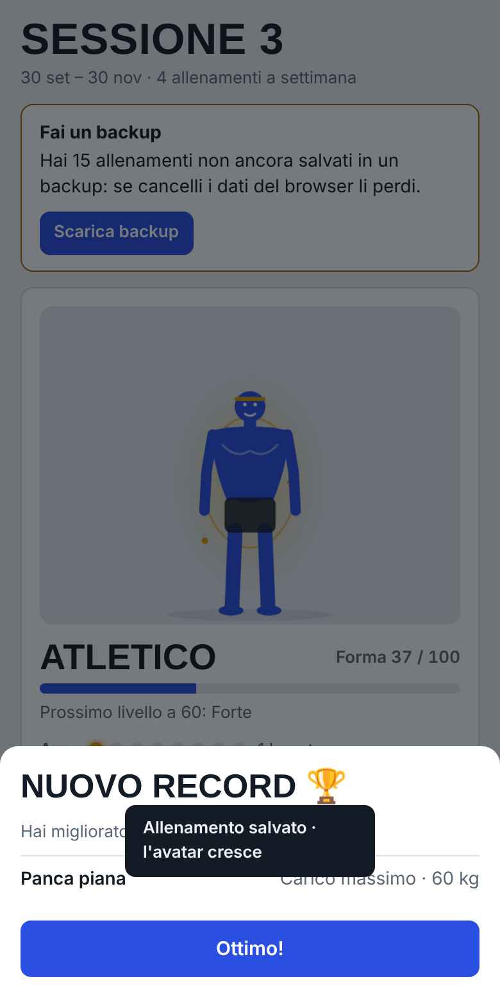
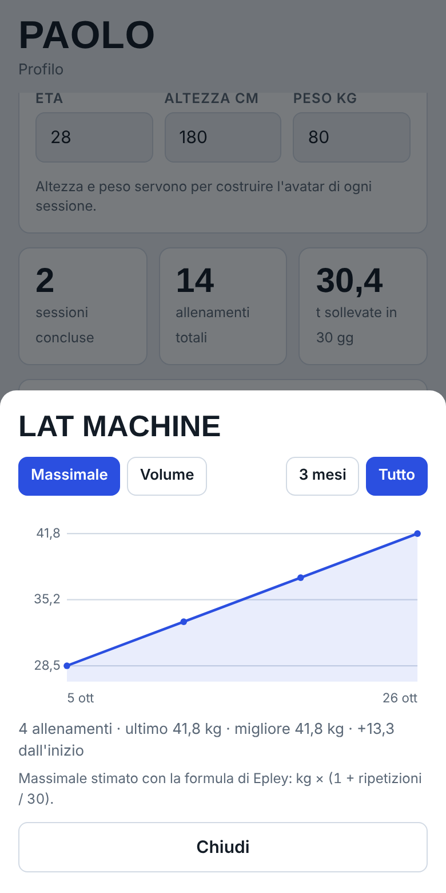

### Avatar
- Parte **piccolo e debole**.
- **Cresce a ogni allenamento** completato.
- A fine settimana (lunedì 00:00) conta `2 × fatti − previsti`. Con 4 allenamenti previsti:
  3 fatti = **+2**; 4 fatti = **+4 e un boost d'aura**; 0 fatti = −4.
- Più **boost d'aura** accumuli, più l'aura è grande e luminosa.
- Se salti troppi allenamenti l'avatar **ingrassa**. Da metà settimana, se sei indietro, compare un avviso.
- Il fisico di partenza dipende da altezza, peso e obiettivo.
- Quattro forme: umano, orso, lupo, gorilla.
- Con le aure si sbloccano gli **accessori**: fascia (1 boost), cintura (3), mantello (5), corona (7).

### Schede con l'IA
Spunti i macchinari della tua palestra (divisi per gruppo muscolare), copi il testo preparato dall'app
in un assistente IA (per esempio Claude), incolli la risposta e le schede vengono importate.

## I tuoi dati

- Restano **sul tuo telefono**, non vengono inviati a nessuno.
- **Backup automatico sul telefono**: l'app tiene una copia al giorno (ultimi 7 giorni) e, se i dati principali sparissero, li recupera da sola. Chiede inoltre al browser di non cancellarli.
- **Backup fuori dal telefono**: **Profilo → Salva backup** apre il menu di condivisione (Drive, iCloud, email, WhatsApp…). Dopo 10 allenamenti non salvati (o 30 giorni) l'app te lo ricorda. Un salvataggio verso un servizio esterno senza che tu tocchi nulla non è possibile da un'app web senza account e server.
- Con **Ripristina** recuperi i dati da una copia automatica o da un file.
- Le GIF vengono da internet; una volta viste restano disponibili offline.
- Aprendo l'app da un altro telefono o browser parte vuota: usa il backup per trasferire i dati.

## Crediti
Le GIF e le miniature degli esercizi sono © Gym visual (https://gymvisual.com/), distribuite nel dataset
[hasaneyldrm/exercises-dataset](https://github.com/hasaneyldrm/exercises-dataset). Sono caricate da lì e non incluse in questa app.
